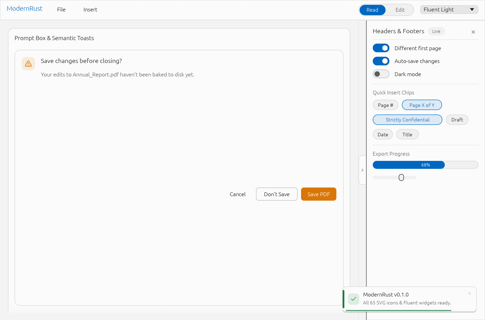
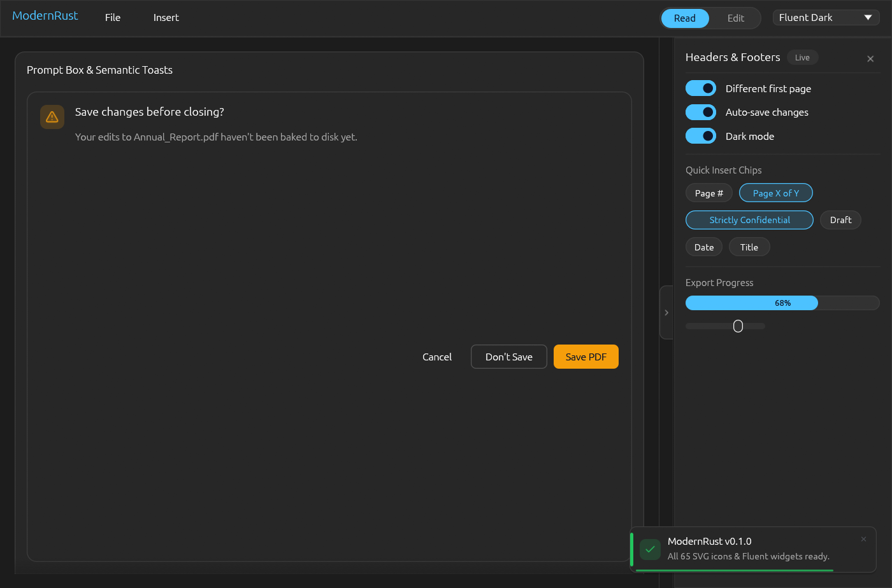
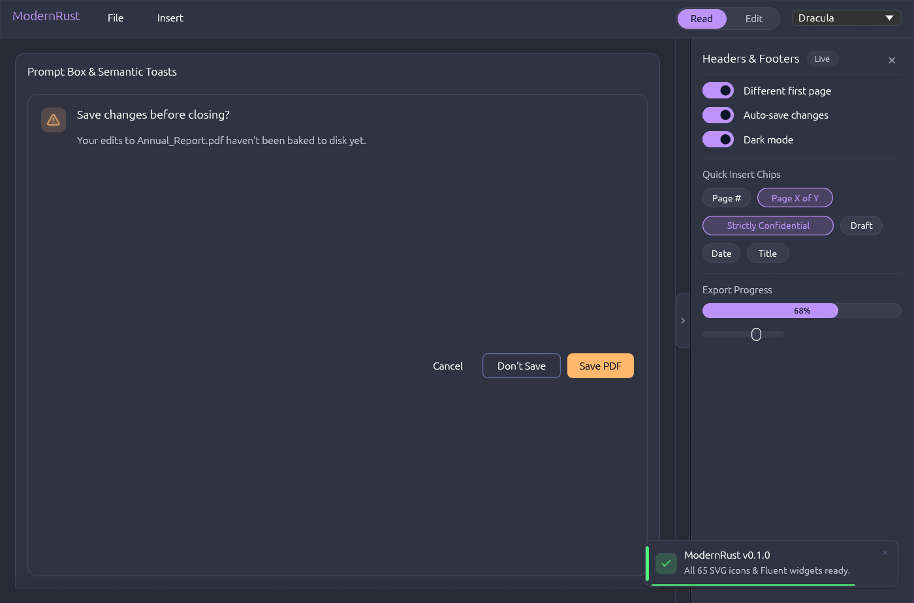

# ModernRust

[](https://github.com/asteng88/ModernRust/actions/workflows/ci.yml)
[](LICENSE)
[](https://www.rust-lang.org/)
[](https://github.com/emilk/egui)

**ModernRust** is a Windows 11 Fluent Design & semantic UI component library for [`egui`](https://github.com/emilk/egui), inspired by `ModernTtk`. It brings cohesive elevation surfaces, Bootstrap-style semantic roles, smooth 60–120 FPS micro-animations, and a compile-time auto-discovered HiDPI SVG icon engine to native Rust desktop apps.

---

## Screenshots

### Fluent Light


### Fluent Dark


### Dracula


---

## Highlights

- **8 Built-In Theme Presets:** `FluentLight`, `FluentDark`, `Cosmo`, `Darkly`, `Cyborg`, `Minty`, `Dracula`, and `ObsidianPaper` — one call to `palette.apply_to_egui(&ctx)` styles the entire `egui` context.
- **8 Semantic Color Roles:** `Primary`, `Secondary`, `Success`, `Info`, `Warning`, `Danger`, `Light`, and `Dark` with automatic contrast-aware text, hover, active, and subtle surface helpers.
- **65 Built-In HiDPI SVG Icons (`resvg` + `tiny-skia`):** Auto-discovered at compile time from `assets/icons/**/*.svg` via `build.rs`, embedded directly into your binary with zero runtime files, dynamically recolored (`currentColor` -> foreground, `#0067C0` -> accent), and cached as GPU `egui::TextureHandle`s.
- **Fluent Widgets:**
  - `modern_button` with `Filled`, `Outline`, `Ghost`, and `Pill` variants + optional leading icon.
  - `segmented_pill` with a smoothly gliding active thumb.
  - `fluent_switch` toggle with animated knob & track transition.
  - `chip` selectable pill tags and `progress_bar` with semantic roles.
- **Animated Menus:** `menu_button` and `show_menu_body` with slide-fade entrance, Fluent vertical accent indicator pill, icon slots, check items, separators, section headers, and shortcut badges.
- **Panels, Cards, Prompts & Toasts:** `side_panel_header`, elevated `section_card`, docked `edge_collapse_tab`, `PromptBox` confirmation cards, and auto-expiring `ToastStack` notifications.
- **Smooth Motion (`anim`):** Ease-out / ease-in-out cubic curves and stateful hover, open, and scalar animation helpers.

---

## Quick Start

Add `modernrust` to your `Cargo.toml`:

```toml
[dependencies]
egui = "0.37"
modernrust = { git = "https://github.com/asteng88/ModernRust.git", tag = "v0.1.0" }
```

Use a theme preset, semantic widgets, and SVG icons in your `egui` app:

```rust
use modernrust::{
    fluent_switch, modern_button, section_card, ButtonVariant, Icon, Role, ThemePreset, ToastStack,
};

let palette = ThemePreset::FluentDark.palette();
palette.apply_to_egui(ctx);

section_card(ui, &palette, Some("Document Actions"), |ui| {
    if modern_button(ui, &palette, "Export PDF", Role::Primary, ButtonVariant::Filled, Some(Icon::Pdf)).clicked() {
        toasts.push("Exported PDF", "Saved searchable vector PDF.", Role::Success, now);
    }
    fluent_switch(ui, &palette, "Auto-save changes", &mut auto_save);
});

toasts.show(ctx, &palette);
```

### Run the Interactive Showcase

Explore every theme, widget, animated menu, prompt box, toast, and all 65 embedded SVG icons live:

```bash
cargo run --example showcase
```

Start directly in a specific theme preset using `MODERNRUST_THEME`:

```bash
# PowerShell
$env:MODERNRUST_THEME="dracula"; cargo run --example showcase

# Bash / Zsh
MODERNRUST_THEME=fluent_dark cargo run --example showcase
```

---

## Built-In Themes

| Preset | Variant | Description |
| --- | --- | --- |
| `ThemePreset::FluentLight` | Light | Windows 11 Fluent Light surface hierarchy & `#0067C0` accent |
| `ThemePreset::FluentDark` | Dark | Windows 11 Fluent Dark mica-inspired charcoal & `#60CDFF` accent |
| `ThemePreset::Cosmo` | Light | Crisp high-contrast daylight palette |
| `ThemePreset::Darkly` | Dark | Deep slate dark mode with vibrant semantic roles |
| `ThemePreset::Cyborg` | Dark | Ultra-dark obsidian surface with electric accents |
| `ThemePreset::Minty` | Light | Soft pastel-mint light palette |
| `ThemePreset::Dracula` | Dark | Classic Dracula purple/pink/cyan theme |
| `ThemePreset::ObsidianPaper` | Dark | Warm editorial dark canvas for writing & reading tools |

---

## Persistent SVG Icon System

Every `.svg` file placed under `assets/icons/<category>/<snake_name>.svg` is automatically discovered by `build.rs` and compiled into `modernrust::Icon`:

- `assets/icons/core/` — 41 core UI icons (navigation, actions, files, alerts, settings, alignment)
- `assets/icons/editorial/` — 24 rich-text & document editing icons (formatting, lists, clipboard, styles)

To add a custom icon, drop any `24×24` SVG following [assets/icons/ICON_SPEC.md](assets/icons/ICON_SPEC.md) into `assets/icons/<category>/` and rebuild. For example, `assets/icons/editorial/highlight.svg` automatically generates `Icon::Highlight` with `Icon::Highlight.category() == "editorial"`.

---

## Module Overview

| Module | Purpose |
| --- | --- |
| `modernrust::theme` | `ThemePreset`, `ThemePalette`, `Role`, color blending, and `apply_to_egui` |
| `modernrust::widgets` | `modern_button`, `segmented_pill`, `fluent_switch`, `chip`, `progress_bar` |
| `modernrust::menu` | `MenuEntry`, `menu_button`, `show_menu_body` |
| `modernrust::panel` | `side_panel_header`, `section_card`, `edge_collapse_tab` |
| `modernrust::prompt` | `PromptBox`, `PromptOutcome`, `ToastStack`, `ToastItem` |
| `modernrust::icons` | `Icon`, `icons::draw`, `icons::widget`, `icons::rasterize_svg` |
| `modernrust::anim` | `ease_out_cubic`, `ease_in_out_cubic`, `animate_hover`, `animate_open`, `animate_scalar` |

---

## Contributing

Contributions are welcome! Please read [CONTRIBUTING.md](CONTRIBUTING.md) and our [Code of Conduct](CODE_OF_CONDUCT.md) before opening a pull request.

## Security

To report a security vulnerability, please see [SECURITY.md](SECURITY.md).

## License

Licensed under the [MIT License](LICENSE) © 2026 asteng88.
